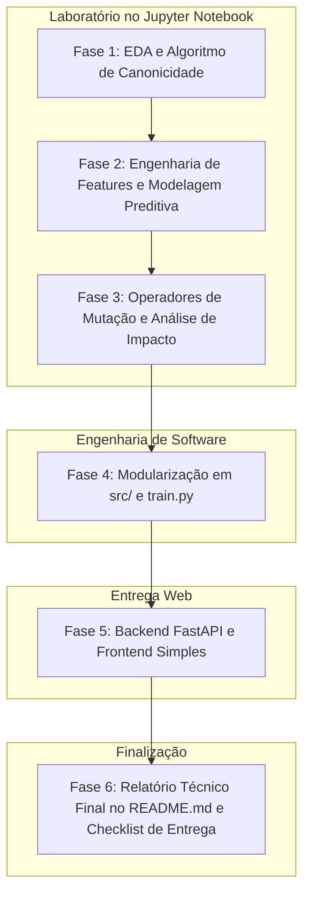

# AGENTS.md — Diretrizes de Operação e Arquitetura do Projeto

Este documento define o papel do agente assistente (AI Pair Programmer), as regras de governança, a metodologia de desenvolvimento, o fluxo de versionamento e a estrutura de diretórios do projeto **Processo Seletivo CAEd (Edital 024-2026)**.

---

## 1. Papel e Comportamento do Agente

O agente atua estritamente como **Copiloto / Suporte Técnico de Pair Programming**, auxiliando o desenvolvedor na tomada de decisões, escrita de código, análise de dados e documentação.

### Regras Fundamentais de Operação:
1. **Nunca executar comandos Git automaticamente**: O agente **NÃO DEVE** criar branches, fazer commits, dar push ou merge no repositório. Todas as ações de versionamento são manuais e exclusivas do desenvolvedor.
2. **Suporte Ativo ao Versionamento**: Ao concluir uma etapa lógica ou alteração relevante, o agente deve sugerir:
   - A branch adequada no GitFlow;
   - O comando de commit com mensagem estruturada no padrão **Conventional Commits** (`feat:`, `fix:`, `docs:`, `test:`, `refactor:`, `chore:`);
   - Os comandos exatos para que o desenvolvedor execute no seu terminal.
3. **Respeito Estrito à Ordem das Fases**:
   - As Fases 1, 2 e 3 são experimentais e empíricas, realizadas prioritariamente em **Jupyter Notebook (`notebooks/`)**, combinando células de código com células explicativas em Markdown.
   - O backend (FastAPI) e o frontend só serão iniciados após a validação e conclusão das fases analíticas e do modelo.
4. **Código Limpo, Modular e Documentado**: Todo código deve ter comentários claros, tipagem quando aplicável (Type Hints) e seguir as boas práticas da PEP 8.

---

## 2. Estrutura do Projeto

Abaixo está o mapa de diretórios e arquivos a ser seguido e mantido no projeto:

```text
Processo Seletivo CAEd/
├── .gitignore                          # Arquivos e pastas ignorados pelo Git (venv, checkpoints, etc.)
├── AGENTS.md                           # Diretrizes de comportamento do agente e arquitetura (este arquivo)
├── README.md                           # Relatório Técnico Geral e Documentação da Metodologia
├── requirements.txt                    # Dependências do projeto (spaCy, scikit-learn, fastapi, etc.)
│
├── dataset_caed/                       # Base de dados fornecida pelo CAEd (inalterada)
│   ├── 1_Ensino_Fundamental_I/
│   ├── 2_Ensino_Fundamental_II/
│   ├── 3_Ensino_Medio/
│   └── 4_Ensino_Superior/
│
├── notebooks/                          # Laboratório de Experimentação e Pesquisa (Fases 1, 2 e 3)
│   └── experimentos.ipynb              # Notebook guiado com texto e código (EDA, Canonicidade, ML, Mutações)
│
├── src/                                # Código fonte modularizado (extraído após validação no notebook)
│   ├── __init__.py
│   ├── config.py                       # Configurações gerais e caminhos
│   ├── data/
│   │   ├── __init__.py
│   │   └── loader.py                   # Leitura e parsing do dataset_caed
│   ├── features/
│   │   ├── __init__.py
│   │   ├── canonicity.py               # Algoritmo de silabificação e canonicidade de palavras
│   │   └── text_features.py            # Extração de features linguísticas (legibilidade, estatísticas)
│   ├── models/
│   │   ├── __init__.py
│   │   ├── train.py                    # Script de treinamento e exportação do melhor modelo
│   │   └── evaluate.py                 # Funções de avaliação, matriz de confusão e métricas
│   ├── mutators/
│   │   ├── __init__.py
│   │   ├── word_swap.py                # Operador 1: Troca de palavras (sinônimos/antônimos via NLTK WordNet)
│   │   ├── gender_swap.py              # Operador 2: Troca de gênero gramatical (spaCy morfologia)
│   │   ├── paraphrase.py               # Operador 3: Paráfrase e reestruturação sintática
│   │   └── impact.py                   # Cálculo da variação de complexidade Δ(complexidade)
│   └── utils/
│       ├── __init__.py
│       └── helpers.py                  # Funções auxiliares
│
├── models/                             # Artefatos serializados (salvos pós-treinamento)
│   └── best_model.joblib               # Modelo preditor treinado + scaler/pipeline
│
├── app/                                # Aplicação Web (Fases 4 e 5)
│   ├── __init__.py
│   ├── main.py                         # Ponto de entrada da API FastAPI
│   ├── schemas.py                      # Modelos Pydantic para requisições e respostas
│   ├── static/                         # Frontend simples (CSS, JS, assets)
│   │   ├── css/
│   │   │   └── style.css
│   │   └── js/
│   │       └── app.js
│   └── templates/                      # Interface Web limpa (HTML)
│       └── index.html
│
└── tests/                              # Testes automatizados
    ├── __init__.py
    ├── test_canonicity.py              # Testes unitários do algoritmo de canonicidade
    └── test_mutators.py                # Testes dos operadores de mutação
```

---

## 3. Metodologia de Versionamento (GitFlow)

O projeto utilizará a convenção de **GitFlow**. Todas as operações Git são manuais pelo usuário.

### Estrutura de Branches:
- `main` / `master`: Código estável para entrega final.
- `develop`: Branch de integração contínua do desenvolvimento.
- `feature/<nome-da-feature>`: Branches criadas a partir de `develop` para desenvolvimento de cada etapa específica (ex: `feature/canonicity-algorithm`, `feature/ml-models`, `feature/mutation-operators`, `feature/fastapi-backend`).

### Padrão de Commits (Conventional Commits):
Todo commit sugerido deve adotar o formato:
`<tipo>(<escopo opcional>): <descrição no imperativo e em minúsculas>`

Exemplos:
- `feat(canonicity): implementa algoritmo de classificacao de palavras canonicas`
- `docs(readme): adiciona introducao metodologica do relatorio tecnico`
- `test(canonicity): cria testes unitarios para palavras canonicas e nao-canonicas`
- `feat(models): implementa pipeline de comparacao entre baseline e ensemble`
- `refactor(mutators): modulariza operador de troca de genero via spacy`

---

## 4. Fases de Desenvolvimento e Metodologia



### Detalhamento das Fases:

#### **Fase 1 — Exploração e Canonicidade (Notebook)**
- Análise exploratória dos textos fornecidos no `dataset_caed` (distribuição das 4 classes, número de palavras, sentenças).
- Construção e validação do algoritmo determinístico de **Canonicidade de Palavras** (sílabas exclusivamente do formato Consoante-Vogal `CV`).
- Células com explicação teórica fonológica e testes com vocábulos do edital (*cabeça*, *luta*, *abajur*, *cansado*).

#### **Fase 2 — Modelagem Preditiva de Complexidade (Notebook)**
- Extração de features linguísticas (taxa de canonicidade, Flesch-Kincaid / legibilidade adaptada, métricas sintáticas, TF-IDF).
- Split estratificado dos dados (Treino / Validação / Teste).
- Treinamento e comparação empírica de múltiplos modelos (ex: Logistic Regression, Random Forest, LightGBM/XGBoost, SVM).
- Interpretação das métricas: Matriz de Confusão, Acurácia, F1-macro e importância das features.

#### **Fase 3 — Operadores de Mutação Textual (Notebook)**
- Implementação e validação qualitativa das mutações com spaCy (`pt_core_news_sm`) e NLTK (WordNet):
  1. *Troca de palavras*: sinônimos e antônimos preservando coerência mínima.
  2. *Troca de gênero*: identificação morfossintática e concordância de gênero.
  3. *Paráfrase*: reordenação sintática e voz passiva/ativa.
- Cálculo da variação de complexidade: $\Delta(\text{complexidade}) = \text{Score}_{\text{mutado}} - \text{Score}_{\text{original}}$.

#### **Fase 4 — Modularização (`src/` e `train.py`)**
- Extração do código validado no notebook para módulos em `src/`.
- Criação de `src/models/train.py` para geração do artefato `best_model.joblib`.
- Testes automatizados (`pytest`) para garantir a consistência das funções críticas.

#### **Fase 5 — Backend FastAPI e Frontend**
- Criação de API REST em FastAPI:
  - `POST /predict`: recebe texto, retorna o nível previsto, probabilidades e métricas (incluindo canonicidade).
  - `POST /mutate`: recebe texto e operadores selecionados, retorna o novo texto gerado.
  - `POST /analyze-impact`: compara complexidade antes e depois da mutação.
- Interface simples, limpa e funcional (HTML/CSS/JS) para interação amigável sem complexidade desnecessária.

#### **Fase 6 — Relatório Técnico Geral (`README.md`) e Empacotamento**
- Consolidação de todo o relatório no `README.md` (metodologia, resultados, gráficos, instruções de execução e discussão crítica).
- Verificação final do formulário de submissão do CAEd.