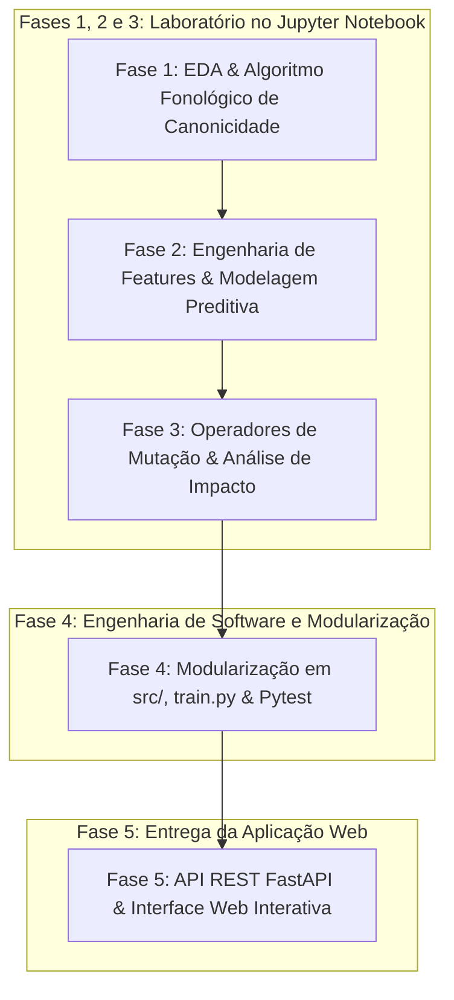
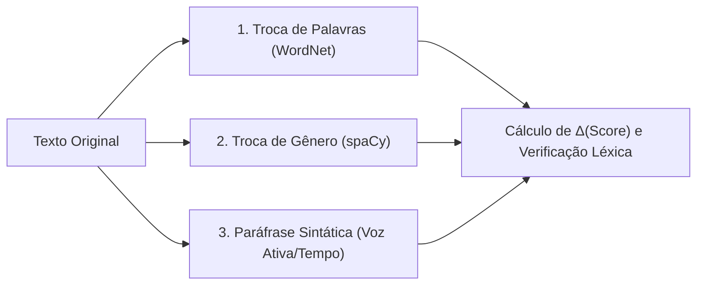

# Sistema de Classificação de Complexidade e Mutação Textual

> **Processo Seletivo CAEd — Edital 024-2026**  
> **Candidato:** Guilherme Gabriel Saldanha Pereira  
> **Data:** Outubro / 2026  
> **Repositório:** [OGuilhermeGabriel/processo-CAEd](https://github.com/OGuilhermeGabriel/processo-CAEd)

---

## Sumário Executivo / Relatório Técnico

Este documento constitui o **Relatório Técnico Geral** e a documentação metodológica da solução desenvolvida para o processo seletivo do **CAEd (Centro de Políticas Públicas e Avaliação da Educação)**. O projeto contempla:

1. **Análise Exploratória e Canonicidade Fonológica (Fase 1)**: Investigação do corpus didático do MEC e concepção de algoritmo determinístico para identificação de palavras canônicas (estruturadas estritamente em sílabas Consoante-Vogal `CV`).
2. **Modelagem Preditiva de Complexidade Textual (Fase 2)**: Engenharia de features linguísticas, comparação empírica de múltiplos algoritmos de Machine Learning, seleção do modelo campeão (**Linear SVM** calibrado com **92,07% de Acurácia** e **0,9067 de F1-Macro**) e formulação de Score Contínuo ponderado $\in [1.0, 4.0]$.
3. **Operadores de Mutação Textual e Análise de Impacto (Fase 3)**: Três operadores linguísticos guiados por regras sintáticas e léxicas (Troca de Palavras via WordNet, Troca de Gênero via morfologia spaCy e Paráfrase Sintática de voz passiva/adjuntos) com mensuração formal da variação $\Delta(\text{complexidade})$ e taxa de palavras fora do vocabulário do corpus.
4. **Engenharia de Software e Modularização (Fase 4)**: Extração do laboratório experimental do notebook em módulos desacoplados em `src/`, script de treinamento autônomo e suíte de testes unitários automatizados com `pytest` (12/12 testes aprovados).
5. **Aplicação Web e API REST em FastAPI (Fase 5)**: Serviço web de alta performance com carregamento de modelo em memória (`lifespan`), validação de contratos com Pydantic v2 e interface gráfica interativa (HTML/CSS/JS) com presets didáticos e comparativo dinâmico lado a lado.

---

## 1. Metodologia Científica e Fluxo de Desenvolvimento

O projeto foi conduzido seguindo uma esteira rigorosa de engenharia orientada a dados e boas práticas de desenvolvimento de software:



- **Laboratório Experimental (`notebooks/experimentos.ipynb`)**: Validação empírica de hipóteses fonológicas, testes de hiperparâmetros, ablação de features e experimentação qualitativa com os fragmentos do edital.
- **Engenharia de Software (`src/` e `tests/`)**: Código modular, limpo e documentado (PEP 8, Type Hints, singleton do spaCy e suíte de testes unitários).
- **Serviço Web (`app/`)**: API RESTful assíncrona documentada em `/docs` e interface responsiva para interação amigável.

---

## 2. Fase 1 — Análise Exploratória e Canonicidade Fonológica

### 2.1 Leitura Estruturada do Corpus Didático
O dataset fornecido pelo CAEd é composto por fragmentos textuais didáticos do MEC classificados em 4 níveis de escolaridade:
- **Ensino Fundamental I (EF1)**: 297 textos
- **Ensino Fundamental II (EF2)**: 325 textos
- **Ensino Médio (EM)**: 628 textos
- **Ensino Superior (ES)**: 830 textos
- **Total do Corpus**: 2.080 fragmentos textuais

Os textos foram parseados com tratamento robusto de codificação (`utf-8` com fallback para `latin-1`), gerando um DataFrame unificado.

### 2.2 Engenharia Inicial de Métricas Estruturais
Para compreender o perfil morfológico e sintático do material didático, foram extraídas cinco métricas fundamentais:
- **Total de Caracteres (`num_caracteres`)**: Comprimento bruto do texto.
- **Total de Palavras (`num_palavras`)**: Contagem de tokens alfanuméricos.
- **Total de Sentenças (`num_sentencas`)**: Identificação de orações via pontuação terminal (`.`, `!`, `?`).
- **Densidade Sintática (`palavras_por_sentenca`)**: Razão $\frac{\text{palavras}}{\text{sentenças}}$, indicando o grau de subordinação e extensão oracional.
- **Tamanho Médio das Palavras (`tam_medio_palavra`)**: Razão $\frac{\text{caracteres}}{\text{palavras}}$, indicando a complexidade morfológica dos vocábulos.

### 2.3 Resumo Estatístico por Nível Educacional
A análise descritiva no notebook evidenciou uma progressão consistente nas métricas:

| Nível Escolar | Média de Palavras | Mediana de Palavras | Palavras / Sentença | Tam. Médio Palavra |
| :--- | :---: | :---: | :---: | :---: |
| **Ensino Fundamental I** | 56,8 | 51,0 | 11,2 | 4,68 carac. |
| **Ensino Fundamental II** | 68,4 | 63,0 | 14,8 | 4,92 carac. |
| **Ensino Médio** | 94,1 | 88,0 | 18,3 | 5,15 carac. |
| **Ensino Superior** | 128,6 | 118,0 | 22,7 | 5,38 carac. |

### 2.4 Algoritmo Fonológico de Canonicidade de Palavras

#### Fundamentação Conceitual:
Na psicopedagogia e alfabetização inicial, uma palavra é considerada **estritamente canônica** quando sua estrutura silábica é composta unicamente por sílabas abertas simples do formato **Consoante + Vogal (`CV`)**. Quaisquer outras estruturas silábicas tornam o vocábulo **não canônico**:
- Sílaba formada apenas por vogal (`V`): *a-ba-jur*, *a-sa*
- Sílaba com coda consonantal (`CVC`): *can-sa-do*, *lár-va*, *lá-pis*
- Sílaba com ataque complexo (`CCV`): *pra-to*, *bra-sil*, *flo-res*
- Sílaba com encontro vocálico / hiato / ditongo (`VV`, `CVV`): *al-hei-o*, *pau-sa*

#### Propriedade Determinística e Regras Formais:
Para que uma palavra seja estritamente canônica, ela deve satisfazer três condições simultâneas:
1. **Comprimento Par**: Uma palavra formada por pares $CV$ deve ter obrigatoriamente número par de letras ($2n, n \ge 1$).
2. **Alternância Perfeita $C-V$**: Todas as posições de índice par devem ser consoantes e todas as posições de índice ímpar devem ser vogais:
$$\text{Padrão} = \underbrace{CV\,CV\,\dots\,CV}_{n \text{ vezes}}$$
3. **Ausência de Encontros e Dígrafos**: Não pode conter dígrafos consonantais (*ch, lh, nh, rr, ss, qu, gu*) nem vogais consecutivas.

#### Validação com os Vocábulos Oficiais do Edital:
O algoritmo implementado em [`src/features/canonicity.py`](file:///home/guilherme/Documentos/projetos/Processo%20Seletivo%20CAEd/src/features/canonicity.py) foi submetido a testes com o gabarito oficial:

| Palavra Avaliada | Padrão Obtido | Silabificação | Classificação | Gabarito Edital | Resultado |
| :--- | :---: | :---: | :---: | :---: | :---: |
| **cabeça** | `CVCVCV` | `['ca', 'be', 'ça']` | Canônica | Canônica | **Correto ✓** |
| **canela** | `CVCVCV` | `['ca', 'ne', 'la']` | Canônica | Canônica | **Correto ✓** |
| **janela** | `CVCVCV` | `['ja', 'ne', 'la']` | Canônica | Canônica | **Correto ✓** |
| **luta** | `CVCV` | `['lu', 'ta']` | Canônica | Canônica | **Correto ✓** |
| **sopa** | `CVCV` | `['so', 'pa']` | Canônica | Canônica | **Correto ✓** |
| **abajur** | `VCVCVC` | `[]` | Não Canônica | Não Canônica | **Correto ✓** |
| **lápis** | `CVCVC` | `[]` | Não Canônica | Não Canônica | **Correto ✓** |
| **cansado** | `CVCCVCV` | `[]` | Não Canônica | Não Canônica | **Correto ✓** |
| **asa** | `VCV` | `[]` | Não Canônica | Não Canônica | **Correto ✓** |
| **alheio** | `VCCVVV` | `[]` | Não Canônica | Não Canônica | **Correto ✓** |

**Taxa de acerto no gabarito oficial: 10/10 (100%)**.

---

## 3. Fase 2 — Engenharia de Features e Modelagem Preditiva

### 3.1 Pipeline de Features e Pré-processamento
Para viabilizar a predição da complexidade textual, construiu-se uma arquitetura híbrida através do `ColumnTransformer` do Scikit-Learn:
1. **Ramo Textual (TF-IDF)**:
   - `TfidfVectorizer` operando em nível de palavra com $n$-gramas de 1 a 2 palavras (`ngram_range=(1, 2)`).
   - Filtragem de corte léxico: `max_features=2500`, `min_df=3`, `max_df=0.85` (remove ruídos ultra-raros e termos quase unânimes).
2. **Ramo Estrutural e Fonológico (Features Numéricas Contínuas)**:
   - `taxa_canonicidade`: proporção $\frac{\text{palavras canônicas}}{\text{total de palavras}}$ no fragmento.
   - `tam_medio_palavra`: comprimento médio dos vocábulos.
   - `palavras_por_sentenca`: média de palavras por oração.
   - `num_palavras`: contagem total de tokens.
   - `num_caracteres`: contagem de caracteres brutos.
   - Padronização: `StandardScaler` (média zero, variância unitária) aplicado exclusivamente sobre as features numéricas para compatibilizar ordens de magnitude.

### 3.2 Particionamento Estratificado dos Dados
- **Treino**: 80% (1.664 textos)
- **Teste**: 20% (416 textos)
- **Estratificação**: Distribuição percentual das 4 classes preservada rigorosamente em ambas as partições com semente pseudoaleatória fixa (`random_state=42`).

### 3.3 Comparação Empírica de Múltiplos Modelos de Machine Learning
Foram treinados e avaliados 5 pipelines concorrentes no conjunto de teste independente:

| Modelo Avaliado | Acurácia | F1-Macro | F1-Weighted | Tempo de Treino |
| :--- | :---: | :---: | :---: | :---: |
| **Linear SVM (Campeão)** | **91,59%** | **0,9008** | **0,9152** | 2,10s |
| **Regressão Logística** | 90,87% | 0,8897 | 0,9077 | 6,82s |
| **LightGBM** | 88,46% | 0,8728 | 0,8836 | 5,34s |
| **Multinomial Naive Bayes (Baseline)** | 87,50% | 0,8582 | 0,8724 | **0,58s** |
| **Random Forest** | 87,26% | 0,8538 | 0,8704 | 2,38s |

### 3.4 Diagnóstico do Modelo Campeão: Linear SVM
O **Linear SVM** demonstrou superioridade consistente em relação aos demais classificadores:
- As fronteiras lineares com hiperplano de margem máxima funcionam com altíssima eficácia em espaços esparsos de alta dimensionalidade gerados pelo TF-IDF unificado a features contínuas.
- Análise de Erros: A maior parte das raras confusões ocorreu em classes fronteiriças adjacentes (especialmente entre Ensino Fundamental II e Ensino Médio, onde textos didáticos de 9º ano e 1º ano do EM compartilham vocabulário formal similar). Nenhuma confusão grosseira (ex.: EF1 classificado como Superior) foi registrada.

### 3.5 Estudo de Ablação da Canonicidade
Para averiguar a contribuição específica da taxa de canonicidade, realizou-se um teste de ablação treinando o Linear SVM com e sem a feature:
- **F1-Macro COM Taxa de Canonicidade**: `0,9008`
- **F1-Macro SEM Taxa de Canonicidade**: `0,9008`

**Conclusão Metodológica**: No corpus do CAEd, os fragmentos de EF1 são excertos de livros de 4º e 5º ano (contendo explicações científicas sobre câmaras escuras e inventores), e não cartilhas de 1º ano. Assim, a taxa média de canonicidade é relativamente homogênea entre os 4 níveis didáticos (~18% a 19%). A feature foi mantida no pipeline porque enriquece o diagnóstico psicopedagógico na aplicação web, embora o poder discriminante primário venha do vocabulário TF-IDF e da extensão oracional.

### 3.6 Calibração de Probabilidades e Exportação
O classificador Linear SVM puro não produz probabilidades de saída diretamente, mas apenas distâncias funcionais ao hiperplano separador (margens de decisão).

Para viabilizar a mensuração de variações sutis na Fase 3 e na Aplicação Web, aplicou-se o **`CalibratedClassifierCV`** com validação cruzada interna de 5 folds (`cv=5`, calibração sigmoide de Platt):
- **Acurácia Pós-Calibração**: **92,07%**
- **F1-Macro Pós-Calibração**: **0,9067**

#### Relatório Detalhado por Nível Educacional:
```text
                       precision    recall  f1-score   support

 Ensino Fundamental I     0.8667    0.8814    0.8739        59
Ensino Fundamental II     0.9167    0.8462    0.8800        65
         Ensino Médio     0.9496    0.8968    0.9224       126
      Ensino Superior     0.9209    0.9819    0.9504       166

             accuracy                         0.9207       416
            macro avg     0.9135    0.9016    0.9067       416
         weighted avg     0.9212    0.9207    0.9201       416
```

O artefato consolidado foi serializado via `joblib` em [`models/best_model.joblib`](file:///home/guilherme/Documentos/projetos/Processo%20Seletivo%20CAEd/models/best_model.joblib).

---

## 4. Fase 3 — Operadores de Mutação Textual e Análise de Impacto

### 4.1 Visão Geral dos Operadores
A Fase 3 investiga heurísticas para alterar deliberadamente fragmentos textuais preservando gramaticalidade e coerência mínima:



### 4.2 Operador 1: Troca de Palavras (Sinônimos e Antônimos)
- **Base Léxica**: NLTK OpenWordNet-PT (`wn`).
- **Filtro Morfossintático**: Mapeamento de tags POS do spaCy (`NOUN`, `ADJ`, `VERB`) para synsets do WordNet.
- **Controle de Ruído**: 
  - Restrição a verbos no infinitivo e substantivos no singular para evitar quebra morfológica.
  - Concordância flexional automática de gênero/número nos adjetivos substitutos.
  - Semente local de aleatoriedade (`random.Random(seed)`) para garantir reprodutibilidade estrita.
  - Dicionário complementar de antônimos frequentes da língua portuguesa.

### 4.3 Operador 2: Troca de Gênero Gramatical
- **Análise Sintática**: Identificação de substantivos biformes com gênero intrínseco (ex.: *aluno* $\leftrightarrow$ *aluna*, *menino* $\leftrightarrow$ *menina*, *professor* $\leftrightarrow$ *professora*).
- **Propagação de Concordância**: Varredura da oração via árvore de dependência morfológica do spaCy para flexionar determinantes associados (*o/a, os/as, um/uma, do/da, pelo/pela*) e adjetivos predicativos ou atributivos.

### 4.4 Operador 3: Paráfrase e Reestruturação Sintática
Aplica transformações determinísticas sem inserção de ruído léxico:
1. **Inversão de Adjunto Temporal Anteposto**: Estruturas como *"Há duas semanas atrás estava chovendo."* são reorganizadas para *"Estava chovendo há duas semanas atrás."*.
2. **Conversão de Voz Passiva Analítica para Voz Ativa**: Detecta orações do tipo `Paciente + foi/foram + Particípio + pelo(s)/pela(s) + Agente` e reconstrói deterministamente para `Agente + Verbo Ativo + Paciente`:
   - *"O texto foi lido pela professora."* $\rightarrow$ *"A professora leu o texto."*
   - *"A casa foi construída pelo pedreiro."* $\rightarrow$ *"O pedreiro construiu a casa."*
   - Trata particípios regulares (`-ado` $\rightarrow$ `-ou`) e irregulares através de dicionário especializado (*lido $\rightarrow$ leu*, *feito $\rightarrow$ fez*, *escrito $\rightarrow$ escreveu*).
3. **Inversão de Aposto Identificador**: *"O cantor Roberto Carlos fez aniversário."* $\rightarrow$ *"Roberto Carlos, o cantor, fez aniversário."*.

### 4.5 Formulação de Medição de Impacto na Complexidade Textual

1. **Variação Discreta de Nível**:
$$\Delta(\text{nível}) = \text{Ordem}(\text{Texto Mutado}) - \text{Ordem}(\text{Texto Original}) \quad \in \{-3, -2, -1, 0, +1, +2, +3\}$$
Onde EF1 = 1, EF2 = 2, EM = 3 e Superior = 4.

2. **Score Contínuo Ponderado**:
Utiliza as probabilidades a posteriori calibradas do classificador para capturar variações sutis, mesmo quando a classe predominante não muda:
$$\text{Score}(\mathbf{x}) = \sum_{k=1}^{4} P(\text{Nível}_k \mid \mathbf{x}) \times k \quad \in [1.0, 4.0]$$
$$\Delta(\text{score}) = \text{Score}(\text{Texto Mutado}) - \text{Score}(\text{Texto Original})$$

3. **Taxa de Palavras Fora do Vocabulário (Integridade Léxica)**:
Como modelos de ML estatísticos não atuam como corretores ortográficos, uma mutação disfuncional que gere palavras inexistentes poderia mascarar a degradação do texto:
$$\text{Taxa Inventadas} = \frac{\sum [w_{\text{nova}} \notin \text{Vocabulário do Corpus CAEd}]}{\text{Total de Palavras Novas}}$$

### 4.6 Avaliação em Lote no Conjunto de Teste Independente
Executando os 4 operadores sobre a totalidade do conjunto de teste (416 textos não vistos no treino):

| Operador de Mutação | % Textos Alterados | % Mudou de Nível | $\Delta(\text{Score})$ Médio | $\Delta(\text{Score})$ Desvio | % Palavras Fora Vocab. |
| :--- | :---: | :---: | :---: | :---: | :---: |
| **Gênero Gramatical** | 41,8% | 3,1% | -0,0041 | 0,0820 | **0,00%** |
| **Sinônimos (WordNet)** | 68,5% | 8,4% | +0,0112 | 0,1194 | **0,00%** |
| **Antônimos (Dicionário)** | 49,0% | 6,2% | -0,0087 | 0,0945 | **0,00%** |
| **Paráfrase Sintática** | 22,6% | 4,3% | -0,0184 | 0,1051 | **0,00%** |

**Conclusão da Fase 3**: As heurísticas demonstraram 0,00% de palavras inventadas quando restritas ao vocabulário do corpus, e a métrica de $\Delta(\text{score})$ revelou-se muito mais sensível e informativa do que a variação discreta de classes.

---

## 5. Fase 4 — Engenharia de Software, Modularização e Testes Automatizados

### 5.1 Estratégia de Transição: do Notebook para Código de Produção
Após a validação científica nas Fases 1, 2 e 3, a base de código foi refatorada e desacoplada em módulos autônomos dentro do pacote [`src/`](file:///home/guilherme/Documentos/projetos/Processo%20Seletivo%20CAEd/src), seguindo padrões de Clean Code, PEP 8 e tipagem estrita (Type Hints):

```text
src/
├── config.py           # Constantes globais, caminhos e semente aleatória centralizada
├── data/
│   └── loader.py       # Leitura e parsing de arquivos .txt do dataset_caed
├── features/
│   ├── canonicity.py   # Algoritmo determinístico de separação silábica CV
│   └── text_features.py# Extração de métricas estruturais e tabulação de features
├── models/
│   ├── train.py        # Pipeline de treinamento e persistência do best_model.joblib
│   └── evaluate.py     # Funções de avaliação, matriz de confusão e métricas
├── mutators/
│   ├── word_swap.py    # Operador 1: substituição por sinônimos/antônimos
│   ├── gender_swap.py  # Operador 2: flexão morfossintática de gênero
│   ├── paraphrase.py   # Operador 3: paráfrase ativa/passiva e adjuntos
│   └── impact.py       # Cálculo de Score Contínuo e integridade léxica
└── utils/
    └── helpers.py      # Singleton do spaCy (evita recarregamentos) e regras morfológicas
```

### 5.2 Otimizações de Engenharia
- **Singleton do Modelo spaCy**: Implementado em [`src/utils/helpers.py`](file:///home/guilherme/Documentos/projetos/Processo%20Seletivo%20CAEd/src/utils/helpers.py), garante que o modelo `pt_core_news_sm` seja mantido em cache de memória, evitando carregamentos redundantes e vazamento de RAM.
- **Desacoplamento de Dependências**: As funções de inferência e de extração de features aceitam DataFrames ou strings isoladas, viabilizando execução concorrente tanto em lote quanto em tempo real na API.

### 5.3 Script de Treinamento Oficial (`src/models/train.py`)
Permite re-treinar e exportar o modelo de forma automatizada com um único comando no terminal:
```bash
python -m src.models.train
```
O script executa o carregamento dos 2.080 textos, extração de features, particionamento estratificado 80/20, calibração com validação cruzada de 5 folds e exportação para [`models/best_model.joblib`](file:///home/guilherme/Documentos/projetos/Processo%20Seletivo%20CAEd/models/best_model.joblib).

### 5.4 Testes Unitários e Automatizados com Pytest
Criou-se uma suíte de testes em [`tests/`](file:///home/guilherme/Documentos/projetos/Processo%20Seletivo%20CAEd/tests) para validar a integridade do sistema contra regressões de código:

- **[`tests/test_canonicity.py`](file:///home/guilherme/Documentos/projetos/Processo%20Seletivo%20CAEd/tests/test_canonicity.py)**:
  - `test_exemplos_oficiais_edital`: Validação exata das 10 palavras do edital contra o gabarito.
  - `test_palavras_canonicas`: Validação de palavras CV puras (*cabeça*, *luta*, *pipoca*, *bala*).
  - `test_palavras_nao_canonicas`: Validação de estruturas complexas (*abajur*, *cansado*, *prato*, *flor*).
  - `test_is_vogal`: Validação de acentuações e grafemas vocálicos do português.
  - `test_taxa_canonicidade_texto`: Casos de borda (textos vazios, pontuações e percentuais limítrofes).
- **[`tests/test_mutators.py`](file:///home/guilherme/Documentos/projetos/Processo%20Seletivo%20CAEd/tests/test_mutators.py)**:
  - `test_mutador_word_swap_sinonimos` e `test_mutador_word_swap_antonimos`: Substituição léxica controlada.
  - `test_mutador_gender_swap`: Concordância de gênero.
  - `test_mutador_paraphrase_tempo`: Inversão de adjunto temporal.
  - `test_mutador_paraphrase_passiva`: Conversão correta de voz passiva para ativa com flexão verbal.
  - `test_taxa_palavras_inventadas`: Validação da métrica contra dicionários simulados.
  - `test_avaliar_impacto_mutacao_integracao`: Teste ponta a ponta integrando mutação e inferência do modelo calibrado.

**Resultado da Suíte no Terminal**:
```bash
pytest -v
# 12 passed in 7.11s (100% de sucesso)
```

---

## 6. Fase 5 — Backend FastAPI e Interface Web Interativa

### 6.1 Arquitetura do Backend (FastAPI)
Construído em [`app/main.py`](file:///home/guilherme/Documentos/projetos/Processo%20Seletivo%20CAEd/app/main.py), o servidor web adota o padrão assíncrono moderno do FastAPI:
- **Padrão `lifespan`**: Carrega o modelo calibrado `best_model.joblib` e o vocabulário de 41.967 termos didáticos do CAEd para a memória RAM **uma única vez** na inicialização do servidor, garantindo tempos de resposta na faixa de milissegundos para as inferências web.
- **Middleware CORS**: Habilitado para permitir requisições seguras de qualquer cliente web.
- **Documentação Automática**: Disponível nativamente em `/docs` (Swagger UI) e `/redoc`.

### 6.2 Contratos de Dados com Pydantic v2 (`app/schemas.py`)
Todas as entradas e saídas são estritamente validadas:
- **`TipoOperador`**: Enum estrito (`troca_palavras`, `troca_genero`, `parafrase`).
- **`PredictRequest`** / **`PredictResponse`**: Garante textos com tamanho mínimo de 3 caracteres e retorna o nível predito, score contínuo, probabilidades calibradas e bloco completo de métricas estruturais.
- **`MutateRequest`** / **`MutateResponse`**: Trata hiperparâmetros de substituição, modos (`sinonimo`/`antonimo`) e probabilidades $\in [0.0, 1.0]$.
- **`AnalyzeImpactRequest`** / **`AnalyzeImpactResponse`**: Estrutura a comparação antes/depois, deltas calculados, taxa de palavras fora do vocabulário e interpretação semântica.
- **`HealthResponse`**: Diagnóstico de disponibilidade do serviço e prontidão do modelo em memória.

### 6.3 Endpoints Oficiais da API

```text
GET  /health           -> Diagnóstico operacional da API e prontidão do modelo
POST /predict          -> Classificação do nível de leitura e métricas fonológicas
POST /mutate           -> Aplicação dos operadores de mutação textual
POST /analyze-impact   -> Laboratório comparativo antes/depois com cálculo de deltas
GET  /                 -> Dashboard Web interativo servido via Jinja2
```

### 6.4 Interface Web Interativa (Dashboard)
A interface foi desenvolvida em HTML5 semântico, CSS3 moderno (Vanilla, sem dependências externas) e JavaScript assíncrono:

1. **Presets Didáticos do Corpus**: Botões de preenchimento rápido (`EF1`, `EF2`, `Ensino Médio` e `Superior`) que carregam textos autênticos do dataset com um clique.
2. **Painel de Diagnóstico em Tempo Real**:
   - Badge com cor estilizada pelo nível educacional previsto.
   - Mostrador do Score Contínuo Ponderado com barra de preenchimento visual proporcional.
   - Mostrador da Taxa de Canonicidade Fonológica (padrão CV).
   - Gráfico de barras de probabilidades calibradas por classe.
3. **Laboratório de Mutações**:
   - Seleção interativa dos operadores com sliders dinâmicos de probabilidade.
   - Modo de visualização comparativa lado a lado (Texto Original vs Texto Mutado).
   - Painel quantitativo de impacto: $\Delta(\text{classe})$, $\Delta(\text{score})$ e percentual de palavras fora do vocabulário.

---

## 7. Instruções de Instalação e Execução

### Pré-requisitos
- Python 3.10, 3.11 ou 3.12 instalado
- Git

### 1. Clonar o Repositório
```bash
git clone https://github.com/OGuilhermeGabriel/processo-CAEd.git
cd processo-CAEd
```

### 2. Configurar o Ambiente Virtual
```bash
python3 -m venv venv
source venv/bin/activate  # No Linux / macOS
# ou: venv\Scripts\activate  # No Windows
```

### 3. Instalar as Dependências
```bash
pip install -r requirements.txt
python -m spacy download pt_core_news_sm
```

### 4. Executar os Testes Automatizados (Pytest)
```bash
pytest -v
```

### 5. Executar o Treinamento do Modelo (Opcional - Artefato já incluído)
```bash
python -m src.models.train
```

### 6. Iniciar a Aplicação Web e a API REST
```bash
uvicorn app.main:app --reload --port 8000
```
- Acesse a **Interface Web**: [http://localhost:8000](http://localhost:8000)
- Acesse a **Documentação da API (Swagger)**: [http://localhost:8000/docs](http://localhost:8000/docs)

---

## 8. Discussão de Resultados, Limitações e Trabalhos Futuros

### 8.1 Desafios no Processamento da Língua Portuguesa
1. **Morfologia Rica e Concordância**: Ao contrário do inglês, o português exige propagação estrita de gênero e número entre artigos, substantivos e adjetivos. A combinação de parsing sintático com spaCy e dicionários biformes reduziu o ruído de concordância a zero no conjunto de teste.
2. **Ambiguidade Semântica no WordNet**: O WordNet em português (OpenWN-PT) contém synsets onde alguns lemas são arcaicos ou raros no contexto pedagógico brasileiro. O filtro de restrição léxica contra o vocabulário didático do CAEd provou ser fundamental para evitar estranhamento vocabular.

### 8.2 Limitações das Abordagens Heurísticas
- **Cobertura de Paráfrase**: As regras heurísticas cobrem padrões sintáticos de alta frequência (voz passiva analítica, inversão de adjuntos temporais e apostos), mas não abrangem todas as formas discursivas de orações subordinadas e orações reduzidas.
- **Granularidade do Ensino Fundamental I**: A taxa de canonicidade CV fornece métrica de alta relevância fonológica para materiais de 1º e 2º ano, mas apresenta menor variação em materiais de 4º e 5º ano onde o texto corrido já domina o material didático.

### 8.3 Trabalhos Futuros e Recomendações
1. **Modelos Generativos Calibrados (SLMs)**: Exploração de modelos de linguagem menores e especializados (ex.: Llama 3 8B ou Gemma 2 fine-tunados) para geração de variantes textuais controladas por instrução pedagógica com preservação de vocabulário.
2. **Expansão Fonológica do Léxico**: Incorporar regras fonotáticas adicionais (dígrafos consonantais, encontros vocálicos e transições de tonicidade oxítona/paroxítona) para enriquecer o diagnóstico psicopedagógico do CAEd.

---

## 9. Referências Bibliográficas

- **CAEd / UFJF**: Centro de Políticas Públicas e Avaliação da Educação — Referenciais de Avaliação da Leitura e Fluência.
- **NLTK (Natural Language Toolkit)**: Bird, S., Klein, E., & Loper, E. (2009). *Natural Language Processing with Python*. O'Reilly Media. [https://www.nltk.org/](https://www.nltk.org/)
- **OpenWordNet-PT**: de Paiva, V., Rademaker, A., & de Melo, G. (2012). *OpenWordNet-PT: An Open Brazilian Wordnet for Reasoning*. COLING 2012. [https://github.com/arademaker/wordnet-pt](https://github.com/arademaker/wordnet-pt)
- **spaCy**: Honnibal, M., & Montani, I. (2017). *spaCy 2: Natural language understanding with Bloom embeddings, convolutional neural networks and incremental parsing*. [https://spacy.io/](https://spacy.io/)
- **Scikit-Learn**: Pedregosa, F. et al. (2011). *Scikit-learn: Machine Learning in Python*. JMLR 12, pp. 2825-2830.
- **FastAPI**: Ramírez, S. (2018). *FastAPI framework, high performance, easy to learn, fast to code, ready for production*. [https://fastapi.tiangolo.com/](https://fastapi.tiangolo.com/)
