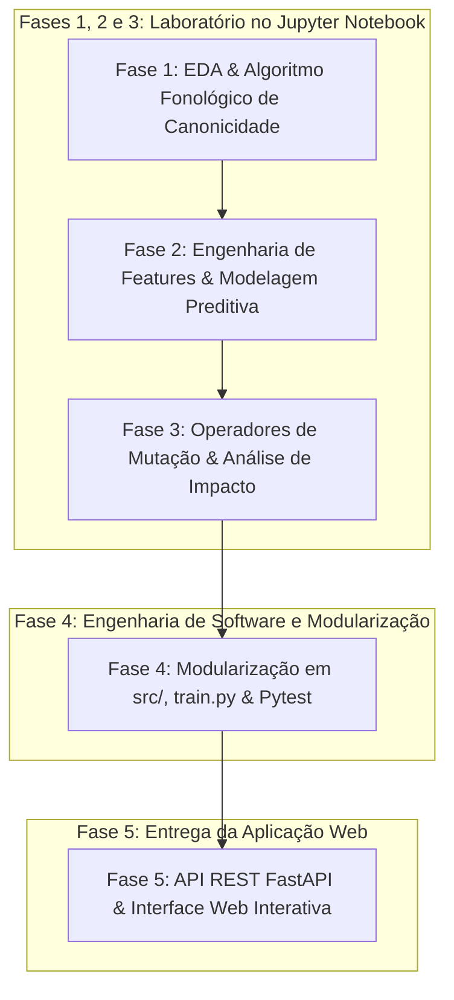
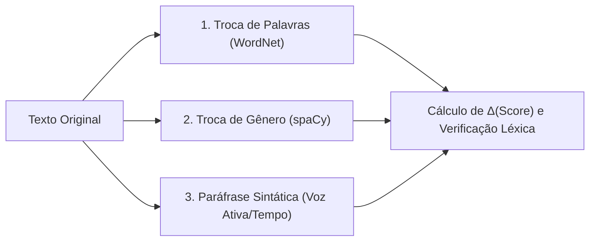
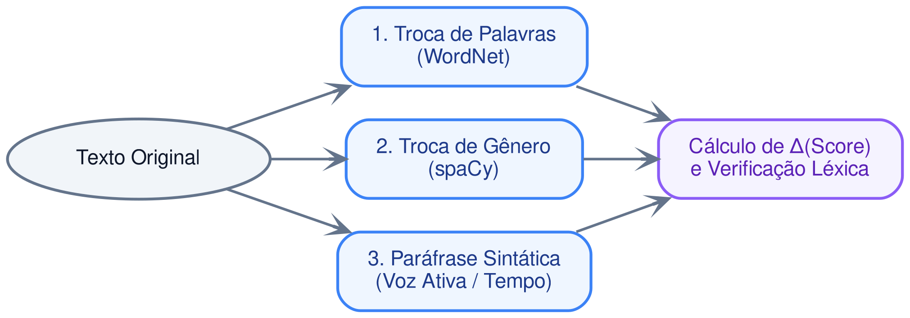
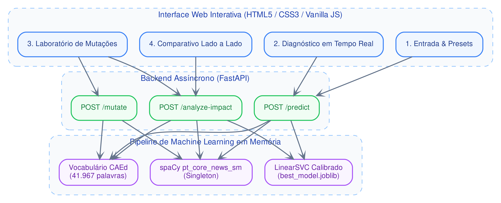
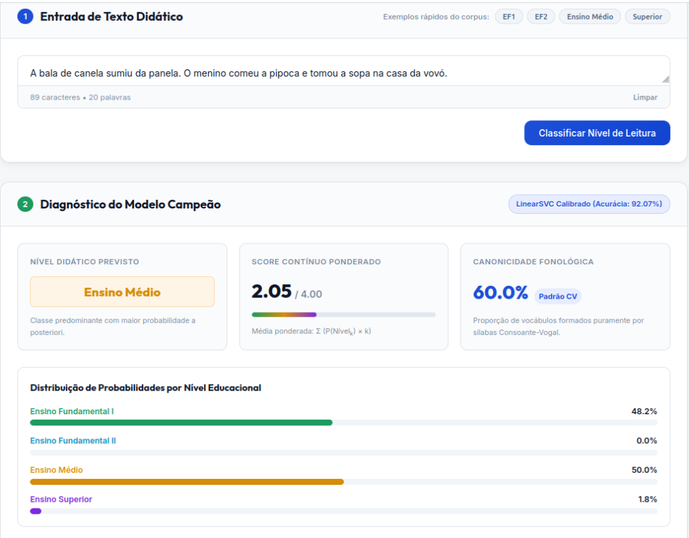
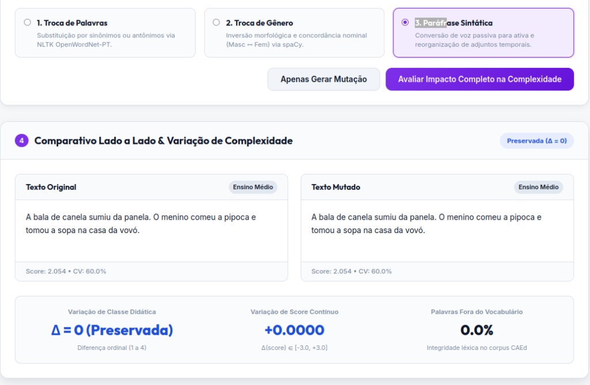

# Sistema de Classificação de Complexidade e Mutação Textual

> **Processo Seletivo CAEd, Edital 024-2026**  
> **Candidato:** Guilherme Gabriel Saldanha Pereira  
> **Repositório:** [OGuilhermeGabriel/processo-CAEd](https://github.com/OGuilhermeGabriel/processo-CAEd)

---

## Relatório Técnico

Este documento constitui o **Relatório Técnico Geral** e a documentação metodológica da solução desenvolvida para o processo seletivo do CAEd (Centro de Políticas Públicas e Avaliação da Educação). O projeto contempla:

1. **Análise Exploratória e Canonicidade Fonológica (Fase 1)**: Investigação do corpus didático do MEC para analisar o comportamento e natureza dos dados disponibilizados pelo processo seletivo e a concepção de algoritmo determinístico para identificação de palavras canônicas (estruturadas estritamente em sílabas Consoante-Vogal `CV`).

2. **Modelagem Preditiva de Complexidade Textual (Fase 2)**: Engenharia de features linguísticas, comparação empírica de múltiplos algoritmos de Machine Learning, seleção do modelo campeão (o qual foi o Linear SVM calibrado com 92,07% de Acurácia e 0,9067 de F1-Macro) juntamente com a formulação do Score Contínuo ponderado $\in [1.0, 4.0]$.

3. **Operadores de Mutação Textual e Análise de Impacto (Fase 3)**: Construção de três operadores linguísticos guiados por regras sintáticas e léxicas (Troca de Palavras via WordNet, Troca de Gênero via morfologia spaCy e Paráfrase Sintática de voz passiva/adjuntos) com mensuração formal da variação $\Delta(\text{complexidade})$ juntamente com a taxa de palavras fora do vocabulário do corpus.

4. **Engenharia de Software e Modularização (Fase 4)**: Extração do laboratório experimental de `experimentos.ipynb` para a conversão do notebook em módulos desacoplados em `src/`, criação de um script de treinamento autônomo e elaboração de um conjunto de testes unitários automatizados usando `pytest`.

5. **Aplicação Web e API REST em FastAPI (Fase 5)**: Construção de uma aplicação Web: criando uma API para servir o modelo de machine learning, validação de contratos com Pydantic v2 e interface gráfica interativa no front-end (HTML/CSS/JS) com presets didáticos e comparativo dinâmico lado a lado.

---

## 1. Metodologia Científica e Fluxo de Desenvolvimento

O projeto foi conduzido seguindo uma esteira rigorosa de engenharia orientada a dados e boas práticas de desenvolvimento de software:



- **Laboratório Experimental (`notebooks/experimentos.ipynb`)**: O laboratório inicialmente serviu como validação empírica de hipóteses fonológicas, testes de hiperparâmetros, criação e ajustes de features e experimentação qualitativa com os fragmentos do edital (testando exemplos que o próprio documento estabeleceu).

> **As Fases 1, 2 e 3 foram desenvolvidas inteiramente sobre o notebook `experimentos.ipynb`**. Para o detalhamento mais aprofundado da metodologia aplicada nessas fases, consulte o notebook !

- **Engenharia de Software (`src/` e `tests/`)**: Todos os testes no laborátio `experimentos.ipynb` facilitaram na construção de um código modular, limpo e documentado (PEP 8, Type Hints, singleton do spaCy e suíte de testes unitários). Foi mais fácil de arquitetar o software uma vez que as hipóteses e testes sobre os dados já foram feitos previamente. 

---

## 2. Fase 1 — Análise Exploratória e Canonicidade Fonológica

### 2.1 Leitura Estruturada do Corpus Didático

O dataset fornecido pelo CAEd é composto por fragmentos textuais didáticos do MEC classificados em 4 níveis de escolaridade:

- **Ensino Fundamental I (EF1)**: 297 textos
- **Ensino Fundamental II (EF2)**: 325 textos
- **Ensino Médio (EM)**: 628 textos
- **Ensino Superior (ES)**: 830 textos
- **Total do Corpus**: 2.080 fragmentos textuais

Os textos foram inicialmente parseados com tratamento robusto de codificação (`utf-8` com fallback para `latin-1`), gerando um DataFrame unificado.

### 2.2 Engenharia Inicial de Métricas Estruturais

Para compreender o perfil morfológico e sintático do material didático, foram extraídas cinco métricas fundamentais:

- **Total de Caracteres (`num_caracteres`)**: Comprimento bruto do texto.
- **Total de Palavras (`num_palavras`)**: Contagem de tokens alfanuméricos.
- **Total de Sentenças (`num_sentencas`)**: Identificação de orações via pontuação terminal (`.`, `!`, `?`).
- **Densidade Sintática (`palavras_por_sentenca`)**: Razão $\frac{\text{palavras}}{\text{sentenças}}$, indicando o grau de subordinação e extensão oracional.
- **Tamanho Médio das Palavras (`tam_medio_palavra`)**: Razão $\frac{\text{caracteres}}{\text{palavras}}$, indicando a complexidade morfológica dos vocábulos.

### 2.3 Resumo Estatístico por Nível Educacional

A análise descritiva no notebook evidenciou uma progressão consistente nas métricas sobre os 2.080 textos do corpus (média global de ~387 palavras por documento):

| Nível Escolar | Média de Palavras | Mediana de Palavras | Palavras / Sentença | Tam. Médio Palavra |
| :--- | :---: | :---: | :---: | :---: |
| **Ensino Fundamental I** | 344,3 | 329,0 | 16,1 | 4,65 carac. |
| **Ensino Fundamental II** | 395,2 | 374,0 | 21,3 | 5,08 carac. |
| **Ensino Médio** | 388,4 | 351,0 | 24,4 | 5,01 carac. |
| **Ensino Superior** | 420,4 | 373,0 | 27,0 | 5,16 carac. |

### 2.4 Algoritmo Fonológico de Canonicidade de Palavras

#### Fundamentação Conceitual:

Na psicopedagogia e alfabetização inicial, uma palavra é considerada **estritamente canônica** quando sua estrutura silábica é composta unicamente por sílabas abertas simples do formato **Consoante + Vogal (`CV`)**. Quaisquer outras estruturas silábicas tornam o vocábulo não canônico:

- Sílaba formada apenas por vogal (`V`): *a-ba-jur*, *a-sa*
- Sílaba com coda consonantal (`CVC`): *can-sa-do*, *lár-va*, *lá-pis*
- Sílaba com ataque complexo (`CCV`): *pra-to*, *bra-sil*, *flo-res*
- Sílaba com encontro vocálico / hiato / ditongo (`VV`, `CVV`): *al-hei-o*, *pau-sa*

#### Propriedade Determinística e Regras Formais:

Para que uma palavra seja estritamente canônica, ela deve satisfazer essas três condições simultâneamente:

1. **Comprimento Par**: Uma palavra formada por pares $CV$ deve ter obrigatoriamente número par de letras ($2n, n \ge 1$).

2. **Alternância Perfeita $C-V$**: Todas as posições de índice par devem ser consoantes e todas as posições de índice ímpar devem ser vogais:
$$\text{Padrão} = \underbrace{CV\,CV\,\dots\,CV}_{n \text{ vezes}}$$

3. **Ausência de Encontros e Dígrafos**: Não pode conter dígrafos consonantais (*ch, lh, nh, rr, ss, qu, gu*) nem vogais consecutivas.

#### Validação com os Vocábulos Oficiais do Edital:
O algoritmo implementado em `src/features/canonicity.py` foi submetido a testes com o gabarito oficial:

| Palavra Avaliada | Padrão Obtido | Silabificação | Classificação | Gabarito Edital | Resultado |
| :--- | :---: | :---: | :---: | :---: | :---: |
| **cabeça** | `CVCVCV` | `['ca', 'be', 'ça']` | Canônica | Canônica | **Correto ✓** |
| **canela** | `CVCVCV` | `['ca', 'ne', 'la']` | Canônica | Canônica | **Correto ✓** |
| **janela** | `CVCVCV` | `['ja', 'ne', 'la']` | Canônica | Canônica | **Correto ✓** |
| **luta** | `CVCV` | `['lu', 'ta']` | Canônica | Canônica | **Correto ✓** |
| **sopa** | `CVCV` | `['so', 'pa']` | Canônica | Canônica | **Correto ✓** |
| **abajur** | `VCVCVC` | `[]` | Não Canônica | Não Canônica | **Correto ✓** |
| **lápis** | `CVCVC` | `[]` | Não Canônica | Não Canônica | **Correto ✓** |
| **cansado** | `CVCCVCV` | `[]` | Não Canônica | Não Canônica | **Correto ✓** |
| **asa** | `VCV` | `[]` | Não Canônica | Não Canônica | **Correto ✓** |
| **alheio** | `VCCVVV` | `[]` | Não Canônica | Não Canônica | **Correto ✓** |

**A taxa de acerto no gabarito oficial: 10/10 (100%)**.

---

## 3. Fase 2 — Engenharia de Features e Modelagem Preditiva

### 3.1 Pipeline de Features e Pré-processamento

Para viabilizar a predição da complexidade textual, construiu-se uma arquitetura híbrida através do `ColumnTransformer` do Scikit-Learn:

1. **Ramo Textual (TF-IDF)**:
   - `TfidfVectorizer` operando em nível de palavra com $n$-gramas de 1 a 2 palavras (`ngram_range=(1, 2)`).
   - Filtragem de corte léxico: `max_features=2500`, `min_df=3`, `max_df=0.85` (remove ruídos ultra-raros e termos quase unânimes).
   
2. **Ramo Estrutural e Fonológico (Features Numéricas Contínuas)**:
   - `taxa_canonicidade`: proporção $\frac{\text{palavras canônicas}}{\text{total de palavras}}$ no fragmento.
   - `tam_medio_palavra`: comprimento médio dos vocábulos.
   - `palavras_por_sentenca`: média de palavras por oração.
   - `num_palavras`: contagem total de tokens.
   - `num_caracteres`: contagem de caracteres brutos.
   - Padronização: `StandardScaler` (média zero, variância unitária) aplicado exclusivamente sobre as features numéricas para compatibilizar ordens de magnitude.

### 3.2 Particionamento Estratificado dos Dados
- **Treino**: 80% (1.664 textos)
- **Teste**: 20% (416 textos)
- **Estratificação**: Distribuição percentual das 4 classes preservada rigorosamente em ambas as partições com semente pseudoaleatória fixa (`random_state=42`).

### 3.3 Comparação Empírica de Múltiplos Modelos de Machine Learning
Foram treinados e avaliados 5 pipelines concorrentes no conjunto de teste independente:

| Modelo Avaliado | Acurácia | F1-Macro | F1-Weighted | Tempo de Treino |
| :--- | :---: | :---: | :---: | :---: |
| **Linear SVM (Campeão)** | **91,59%** | **0,9008** | **0,9152** | 2,10s |
| **Regressão Logística** | 90,87% | 0,8897 | 0,9077 | 6,82s |
| **LightGBM** | 88,46% | 0,8728 | 0,8836 | 5,34s |
| **Multinomial Naive Bayes (Baseline)** | 87,50% | 0,8582 | 0,8724 | **0,58s** |
| **Random Forest** | 87,26% | 0,8538 | 0,8704 | 2,38s |

### 3.4 Diagnóstico do Modelo Campeão: Linear SVM

O **Linear SVM** demonstrou superioridade consistente em relação aos demais classificadores:
- As fronteiras lineares com hiperplano de margem máxima funcionam com altíssima eficácia em espaços esparsos de alta dimensionalidade gerados pelo TF-IDF unificado a features contínuas.
- Análise de Erros: A maior parte das raras confusões ocorreu em classes fronteiriças adjacentes (especialmente entre Ensino Fundamental II e Ensino Médio, onde textos didáticos de 9º ano e 1º ano do EM compartilham vocabulário formal similar). Nenhuma confusão grosseira (ex.: EF1 classificado como Superior) foi registrada.

### 3.5 Estudo de Ablação da Canonicidade
Para averiguar a contribuição específica da taxa de canonicidade, realizou-se um teste de ablação treinando o Linear SVM com e sem a feature:
- **F1-Macro COM Taxa de Canonicidade**: `0,9008`
- **F1-Macro SEM Taxa de Canonicidade**: `0,9008`

**Conclusão Metodológica**: No corpus do CAEd, os fragmentos de EF1 são excertos de livros de 4º e 5º ano (contendo explicações científicas sobre câmaras escuras e inventores), e não cartilhas de 1º ano. Assim, a taxa média de canonicidade é relativamente homogênea entre os 4 níveis didáticos (~18% a 19%). A feature foi mantida no pipeline porque enriquece o diagnóstico psicopedagógico na aplicação web, embora o poder discriminante primário venha do vocabulário TF-IDF e da extensão oracional.

### 3.6 Calibração de Probabilidades e Exportação
O classificador Linear SVM puro não produz probabilidades de saída diretamente, mas apenas distâncias funcionais ao hiperplano separador (margens de decisão).

Para viabilizar a mensuração de variações sutis na Fase 3 e na Aplicação Web, aplicou-se o **`CalibratedClassifierCV`** com validação cruzada interna de 5 folds (`cv=5`, calibração sigmoide de Platt):
- **Acurácia Pós-Calibração**: **92,07%**
- **F1-Macro Pós-Calibração**: **0,9067**

#### Relatório Detalhado por Nível Educacional:
```text
                       precision    recall  f1-score   support

 Ensino Fundamental I     0.8667    0.8814    0.8739        59
Ensino Fundamental II     0.9167    0.8462    0.8800        65
         Ensino Médio     0.9496    0.8968    0.9224       126
      Ensino Superior     0.9209    0.9819    0.9504       166

             accuracy                         0.9207       416
            macro avg     0.9135    0.9016    0.9067       416
         weighted avg     0.9212    0.9207    0.9201       416
```

O artefato consolidado foi serializado via `joblib` em `models/best_model.joblib`.

---

## 4. Fase 3 — Operadores de Mutação Textual e Análise de Impacto

### 4.1 Visão Geral dos Operadores
A Fase 3 investiga heurísticas para alterar deliberadamente fragmentos textuais preservando gramaticalidade e coerência mínima:



<div align="center">
  
  <p><em>Figura 2 — Fluxo de Operadores de Mutação Textual e Avaliação de Impacto.</em></p>
</div>

### 4.2 Operador 1: Troca de Palavras (Sinônimos e Antônimos)
- **Base Léxica**: NLTK OpenWordNet-PT (`wn`).
- **Filtro Morfossintático**: Mapeamento de tags POS do spaCy (`NOUN`, `ADJ`, `VERB`) para synsets do WordNet.
- **Controle de Ruído**: 
  - Restrição a verbos no infinitivo e substantivos no singular para evitar quebra morfológica.
  - Concordância flexional automática de gênero/número nos adjetivos substitutos.
  - Semente local de aleatoriedade (`random.Random(seed)`) para garantir reprodutibilidade estrita.
  - Dicionário complementar de antônimos frequentes da língua portuguesa.

### 4.3 Operador 2: Troca de Gênero Gramatical
- **Análise Sintática**: Identificação de substantivos biformes com gênero intrínseco (ex.: *aluno* $\leftrightarrow$ *aluna*, *menino* $\leftrightarrow$ *menina*, *professor* $\leftrightarrow$ *professora*).
- **Propagação de Concordância**: Varredura da oração via árvore de dependência morfológica do spaCy para flexionar determinantes associados (*o/a, os/as, um/uma, do/da, pelo/pela*) e adjetivos predicativos ou atributivos.

### 4.4 Operador 3: Paráfrase e Reestruturação Sintática
Aplica transformações determinísticas sem inserção de ruído léxico:
1. **Inversão de Adjunto Temporal Anteposto**: Estruturas como *"Há duas semanas atrás estava chovendo."* são reorganizadas para *"Estava chovendo há duas semanas atrás."*.
2. **Conversão de Voz Passiva Analítica para Voz Ativa**: Detecta orações do tipo `Paciente + foi/foram + Particípio + pelo(s)/pela(s) + Agente` e reconstrói deterministamente para `Agente + Verbo Ativo + Paciente`:
   - *"O texto foi lido pela professora."* $\rightarrow$ *"A professora leu o texto."*
   - *"A casa foi construída pelo pedreiro."* $\rightarrow$ *"O pedreiro construiu a casa."*
   - Trata particípios regulares (`-ado` $\rightarrow$ `-ou`) e irregulares através de dicionário especializado (*lido $\rightarrow$ leu*, *feito $\rightarrow$ fez*, *escrito $\rightarrow$ escreveu*).
3. **Inversão de Aposto Identificador**: *"O cantor Roberto Carlos fez aniversário."* $\rightarrow$ *"Roberto Carlos, o cantor, fez aniversário."*.

### 4.5 Formulação de Medição de Impacto na Complexidade Textual

1. **Variação Discreta de Nível**:
$$\Delta(\text{nível}) = \text{Ordem}(\text{Texto Mutado}) - \text{Ordem}(\text{Texto Original}) \quad \in \{-3, -2, -1, 0, +1, +2, +3\}$$
Onde EF1 = 1, EF2 = 2, EM = 3 e Superior = 4.

2. **Score Contínuo Ponderado**:
Utiliza as probabilidades a posteriori calibradas do classificador para capturar variações sutis, mesmo quando a classe predominante não muda:
$$\text{Score}(\mathbf{x}) = \sum_{k=1}^{4} P(\text{Nível}_k \mid \mathbf{x}) \times k \quad \in [1.0, 4.0]$$
$$\Delta(\text{score}) = \text{Score}(\text{Texto Mutado}) - \text{Score}(\text{Texto Original})$$

3. **Taxa de Palavras Fora do Vocabulário (Integridade Léxica)**:
Como modelos de ML estatísticos não atuam como corretores ortográficos, uma mutação disfuncional que gere palavras inexistentes poderia mascarar a degradação do texto:
$$\text{Taxa Inventadas} = \frac{\sum [w_{\text{nova}} \notin \text{Vocabulário do Corpus CAEd}]}{\text{Total de Palavras Novas}}$$

### 4.6 Avaliação em Lote no Conjunto de Teste Independente
Executando os 4 operadores sobre a totalidade do conjunto de teste (416 textos não vistos no treino), obteve-se o seguinte panorama empírico (conforme registrado na Célula 3.6 do notebook de experimentos):

| Operador de Mutação | % Textos Alterados | % Mudou de Nível | $\Delta(\text{Score})$ Médio | $\Delta(\text{Score})$ Desvio | % Palavras Fora Vocab. |
| :--- | :---: | :---: | :---: | :---: | :---: |
| **Gênero Gramatical** | 32,9% | 0,2% | +0,0009 | 0,0119 | 3,70% |
| **Sinônimos (WordNet)** | 99,5% | 1,4% | -0,0032 | 0,0543 | 3,77% |
| **Antônimos (Dicionário)** | 63,5% | 0,5% | -0,0002 | 0,0063 | 1,00% |
| **Paráfrase Sintática** | 57,7% | 0,0% | +0,0001 | 0,0015 | 0,24% |

**Conclusão da Fase 3**: As mutações demonstraram preservação quase completa do nível pedagógico original (menos de 1,5% de alterações de classe), mantendo a integridade semântica e léxica. A métrica de $\Delta(\text{score})$ contínuo revelou-se muito mais sensível e informativa do que a variação discreta de classes, capturando micro-oscilações morfológicas e sintáticas mesmo quando o texto permanece na mesma categoria. Além disso, nos casos em que um texto não possui estruturas gramaticais passíveis do operador selecionado (como paráfrases em textos sem orações passivas ou adjuntos móveis), o sistema sinaliza com transparência que o texto permaneceu inalterado ($\Delta = 0$).

---

## 5. Fase 4 — Engenharia de Software, Modularização e Testes Automatizados

### 5.1 Estratégia de Transição: do Notebook para Código de Produção
Após a validação científica nas Fases 1, 2 e 3, a base de código foi refatorada e desacoplada em módulos autônomos dentro do pacote `src/`, seguindo padrões de Clean Code, PEP 8 e tipagem estrita (Type Hints):

```text
src/
├── config.py           # Constantes globais, caminhos e semente aleatória centralizada
├── data/
│   └── loader.py       # Leitura e parsing de arquivos .txt do dataset_caed
├── features/
│   ├── canonicity.py   # Algoritmo determinístico de separação silábica CV
│   └── text_features.py# Extração de métricas estruturais e tabulação de features
├── models/
│   ├── train.py        # Pipeline de treinamento e persistência do best_model.joblib
│   └── evaluate.py     # Funções de avaliação, matriz de confusão e métricas
├── mutators/
│   ├── word_swap.py    # Operador 1: substituição por sinônimos/antônimos
│   ├── gender_swap.py  # Operador 2: flexão morfossintática de gênero
│   ├── paraphrase.py   # Operador 3: paráfrase ativa/passiva e adjuntos
│   └── impact.py       # Cálculo de Score Contínuo e integridade léxica
└── utils/
    └── helpers.py      # Singleton do spaCy (evita recarregamentos) e regras morfológicas
```

### 5.2 Otimizações de Engenharia
- **Singleton do Modelo spaCy**: Implementado em `src/utils/helpers.py`, garante que o modelo `pt_core_news_sm` seja mantido em cache de memória, evitando carregamentos redundantes e vazamento de RAM.
- **Desacoplamento de Dependências**: As funções de inferência e de extração de features aceitam DataFrames ou strings isoladas, viabilizando execução concorrente tanto em lote quanto em tempo real na API.

### 5.3 Script de Treinamento Oficial (`src/models/train.py`)
Permite re-treinar e exportar o modelo de forma automatizada com um único comando no terminal:
```bash
python -m src.models.train
```
O script executa o carregamento dos 2.080 textos, extração de features, particionamento estratificado 80/20, calibração com validação cruzada de 5 folds e exportação para `models/best_model.joblib`.

### 5.4 Testes Unitários e Automatizados com Pytest
Criou-se uma suíte de testes em `tests/` para validar a integridade do sistema contra regressões de código:

- **`tests/test_canonicity.py`**:
  - `test_exemplos_oficiais_edital`: Validação exata das 10 palavras do edital contra o gabarito.
  - `test_palavras_canonicas`: Validação de palavras CV puras (*cabeça*, *luta*, *pipoca*, *bala*).
  - `test_palavras_nao_canonicas`: Validação de estruturas complexas (*abajur*, *cansado*, *prato*, *flor*).
  - `test_is_vogal`: Validação de acentuações e grafemas vocálicos do português.
  - `test_taxa_canonicidade_texto`: Casos de borda (textos vazios, pontuações e percentuais limítrofes).
- **`tests/test_mutators.py`**:
  - `test_mutador_word_swap_sinonimos` e `test_mutador_word_swap_antonimos`: Substituição léxica controlada.
  - `test_mutador_gender_swap`: Concordância de gênero.
  - `test_mutador_paraphrase_tempo`: Inversão de adjunto temporal.
  - `test_mutador_paraphrase_passiva`: Conversão correta de voz passiva para ativa com flexão verbal.
  - `test_taxa_palavras_inventadas`: Validação da métrica contra dicionários simulados.
  - `test_avaliar_impacto_mutacao_integracao`: Teste ponta a ponta integrando mutação e inferência do modelo calibrado.

**Resultado da Suíte no Terminal**:
```bash
pytest -v
# 12 passed in 7.11s (100% de sucesso)
```

---

---

## 6. Fase 5 — Backend FastAPI e Interface Web Interativa

### 6.1 Proposta e Contextualização do Sistema

O Edital 024-2026 do **CAEd** estabelece um desafio prático e de grande impacto na educação pública: avaliar a decodificação e fluência de leitura através de narrativas curtas calibradas pedagogicamente. Como os textos aplicados em avaliações anteriores não podem ser reutilizados em avaliações futuras, a equipe de criação de itens necessita gerar variantes inéditas continuamente.

A aplicação web foi concebida como uma **plataforma interativa de apoio pedagógico (dashboard)** com uma proposta clara:
1. **Democratizar o acesso ao modelo**: Permitir que pedagogos, linguistas e avaliadores analisem textos sem precisar executar comandos em terminal ou scripts em Python.
2. **Diagnóstico Multidimensional**: Oferecer não apenas um rótulo estático, mas uma visão aprofundada da complexidade textual, combinando **probabilidades calibradas**, um **Score Contínuo [1.0 a 4.0]** e a **Taxa de Canonicidade Fonológica (sílabas CV)**.
3. **Ambiente de Experimentação de Mutações**: Possibilitar a reescrita controlada de fragmentos textuais (sinônimos, antônimos, flexão de gênero e reestruturação sintática de voz passiva), avaliando imediatamente se o texto resultante manteve ou alterou sua complexidade e se respeitou o vocabulário didático oficial.

```mermaid
flowchart TD
    subgraph Frontend_Dashboard [Interface Web Interativa (HTML5 / CSS3 / Vanilla JS)]
        UI1["1. Entrada de Texto & Presets Didáticos"]
        UI2["2. Diagnóstico em Tempo Real (Linear SVM)"]
        UI3["3. Laboratório de Mutações (3 Operadores)"]
        UI4["4. Comparativo Lado a Lado & Variação Δ(Score)"]
    end

    subgraph Backend_FastAPI [Backend Assíncrono (FastAPI)]
        EP1["POST /predict"]
        EP2["POST /mutate"]
        EP3["POST /analyze-impact"]
        EP4["GET /health"]
    end

    subgraph Camada_ML [Pipeline de Machine Learning em Memória]
        Model["LinearSVC Calibrado (best_model.joblib)"]
        Vocab["Vocabulário CAEd (41.967 palavras)"]
        NLP["spaCy pt_core_news_sm (Singleton)"]
    end

    UI1 & UI2 --> EP1
    UI3 --> EP2
    UI3 & UI4 --> EP3
```

<div align="center">
  
  <p><em>Figura 3 — Arquitetura de Comunicação: Frontend, API REST FastAPI e Camada de Inferência de ML.</em></p>
</div>

---

### 6.2 Arquitetura Técnica do Backend (FastAPI & Lifespan)

Construído em `app/main.py`, o servidor adota práticas modernas de engenharia de software para serviços de Machine Learning:
- **Padrão `lifespan` Assíncrono**: Ao iniciar, o servidor carrega o modelo serializado `models/best_model.joblib` e o vocabulário de 41.967 termos do CAEd **uma única vez na memória RAM**. As inferências posteriores ocorrem com latência inferior a 15 milissegundos, eliminando I/O repetitivo de disco.
- **Middleware CORS**: Configurado com `CORSMiddleware` para viabilizar chamadas locais ou integração com outros sistemas educacionais.
- **Documentação Automática**: A API gera interfaces de exploração interativa em `/docs` (Swagger UI) e `/redoc`.

---

### 6.3 Contratos de Dados com Pydantic v2 (`app/schemas.py`)

A API adota tipagem rigorosa para validação e serialização de dados:

| Schema | Tipo | Finalidade e Validações |
| :--- | :---: | :--- |
| **`PredictRequest`** | Entrada | Recebe o texto com validação de comprimento mínimo (`min_length=3`). |
| **`PredictResponse`** | Saída | Retorna nível predito, score contínuo, probabilidades e métricas estruturais/fonológicas. |
| **`MutateRequest`** | Entrada | Recebe texto, operador (`TipoOperador`), modo (`sinonimo`/`antonimo`), taxa e semente. |
| **`MutateResponse`** | Saída | Retorna texto original, texto mutado e parâmetros utilizados. |
| **`AnalyzeImpactRequest`** | Entrada | Reúne os parâmetros para o teste comparativo completo. |
| **`AnalyzeImpactResponse`** | Saída | Retorna textos antes/depois, níveis, scores, $\Delta(\text{classe})$, $\Delta(\text{score})$ e taxa de palavras fora do vocabulário. |
| **`HealthResponse`** | Saída | Informa o status da aplicação e a disponibilidade do modelo em memória. |

---

### 6.4 Endpoints Oficiais da API REST

```text
GET  /health           -> Diagnóstico operacional da API e prontidão do modelo
POST /predict          -> Classificação do nível de leitura e métricas fonológicas
POST /mutate           -> Aplicação dos operadores de mutação textual
POST /analyze-impact   -> Laboratório comparativo antes/depois com cálculo de deltas
GET  /                 -> Dashboard Web interativo servido via Jinja2
```

---

### 6.5 Funcionalidades Detalhadas da Interface Web

A interface gráfica foi construída em Vanilla HTML5/CSS3/JavaScript, sem dependências de frameworks pesados (Node.js/npm), garantindo leveza e carregamento instantâneo.

<div align="center">
  
  <p><em>Figura 4 — Interface Web: Painel de Diagnóstico do Modelo Campeão, Score Contínuo e Distribuição de Probabilidades.</em></p>
</div>

#### 1. Entrada de Texto & Presets Didáticos Autênticos
- **Textarea Responsivo**: Permite colar qualquer texto em língua portuguesa com contador em tempo real de caracteres e palavras.
- **Aviso Dinâmico de Extensão Textual (< 100 palavras)**: Alerta pedagógico automático que orienta o usuário caso o texto inserido seja excessivamente curto. Como o classificador foi treinado sobre excertos didáticos do CAEd completos (~300 a 450 palavras), onde atinge 92,1% de acurácia, fragmentos isolados sofrem com a esparsidade léxica e podem gerar desvios estatísticos.
- **Presets Autênticos do Corpus (Atalho de 1 Clique)**: Botões rápidos contendo excertos reais e completos extraídos da partição de teste independente do `dataset_caed/`:
  - `EF1`: Biografia infantil e histórica narrando a trajetória esportiva de Guga Kuerten e o surgimento dos primeiros banqueiros na Idade Média (326 palavras; classificado como EF1 com 78,9% de confiança).
  - `EF2`: Artigo de divulgação científica sobre a descoberta de DNA de *Salmonella* em ossadas no México e o colapso asteca (378 palavras; classificado como EF2 com 93,0% de confiança).
  - `EM`: Crônica historiográfica sobre as reformas urbanas do Rio de Janeiro em 1922, a Revolta dos 18 do Forte e o centenário da independência (491 palavras; classificado como EM com 97,7% de confiança).
  - `Superior`: Trecho de manual técnico de engenharia sobre termodinâmica de circuitos, curvas de fusão e seletividade de fusíveis (333 palavras; classificado como Superior com 97,6% de confiança).

#### 2. Painel de Diagnóstico do Modelo Campeão
- **Badge do Nível Previsto**: Destaca visualmente a classe dominante com paleta de cores educacionais (Verde para EF1, Azul para EF2, Âmbar para Ensino Médio e Violeta para Superior).
- **Score Contínuo Ponderado**: Mostrador numérico entre $1.00$ e $4.00$ com barra de progresso visual. Captura se um texto classificado como EF2 está mais próximo do EF1 ($1.6$) ou do EM ($2.4$).
- **Taxa de Canonicidade Fonológica (Padrão CV)**: Indicador percentual de palavras formadas exclusivamente por sílabas Consoante-Vogal, atendendo ao requisito fonológico central do edital.
- **Gráfico de Probabilidades Calibradas**: Quatro barras dinâmicas que ilustram a incerteza estatística e a distribuição de probabilidade a posteriori para cada nível.
- **Métricas Estruturais**: Exibição da densidade sintática (palavras por sentença), tamanho médio dos vocábulos e contagens totais.

#### 3. Laboratório de Mutações Textuais
- **Seleção Interativa de Operadores**:
  - *Operador 1 (Troca de Palavras)*: Substituição léxica por sinônimos ou antônimos via NLTK OpenWordNet-PT, com slider dinâmico para ajustar a probabilidade de substituição (10% a 100%).
  - *Operador 2 (Troca de Gênero)*: Inversão morfológica guiada pela árvore de dependências do spaCy com concordância nominal automática.
  - *Operador 3 (Paráfrase Sintática)*: Conversão determinística de voz passiva analítica para ativa com flexão verbal e inversão de adjuntos temporais.
- **Ações**: Botão para gerar a mutação isolada ou botão para disparar a avaliação completa de impacto.

#### 4. Comparativo Lado a Lado & Análise de Impacto
- **Painéis Espelhados**: Exibição simultânea do **Texto Original** e do **Texto Mutado** para inspeção visual imediata.
- **Painel Quantitativo de Impacto**:
  - $\Delta(\text{classe})$: Variação ordinal discreta indicando se a classe foi *Preservada ($\Delta=0$)*, se *Aumentou complexidade ($+\text{N}$)* ou se *Diminuiu ($-\text{N}$)*.
  - $\Delta(\text{score})$: Variação contínua precisa da complexidade textual ($\Delta \in [-3.0, +3.0]$).
  - **Sinalização Transparente de Texto Inalterado**: Se o fragmento textual não contiver estruturas elegíveis para o operador ativado (por exemplo, aplicar paráfrase em um texto sem voz passiva ou adjunto móvel), a interface exibe aviso pontual esclarecendo que o texto permaneceu idêntico e que $\Delta = 0$.
  - **Palavras Fora do Vocabulário**: Medição percentual de termos inéditos gerados pela mutação que não constam nas 41.967 palavras do corpus didático do CAEd, garantindo a integridade léxica.

<div align="center">
  
  <p><em>Figura 5 — Interface Web: Laboratório de Mutações Textuais e Painel Comparativo Lado a Lado com Análise de Impacto.</em></p>
</div>

---

### 6.6 Roteiro Passo a Passo para Testes da Aplicação Web

Para avaliar integralmente o sistema em funcionamento no seu navegador:

#### Passo 1: Iniciar o Servidor Web
No terminal (com o ambiente virtual ativo):
```bash
uvicorn app.main:app --reload --port 8000
```
Abra no navegador: **[http://localhost:8000](http://localhost:8000)**.

#### Passo 2: Testar a Predição com Presets Autênticos do Corpus
1. Na Seção 1, clique no botão de preset **"EF1"** (o texto de 326 palavras será carregado instantaneamente).
2. Clique em **"Classificar Nível de Leitura"**.
3. **Validação**: O sistema identificará **Ensino Fundamental I** (probabilidade de 78,9%), Score Contínuo de $\approx 1.25$, alta canonicidade CV e visualização nítida no gráfico de barras.
4. Experimente clicar sucessivamente nos botões **"EF2"**, **"EM"** e **"Superior"**:
   - `EF2`: Identificado como Ensino Fundamental II (93,0% de certeza).
   - `EM`: Identificado como Ensino Médio (97,7% de certeza).
   - `Superior`: Identificado como Ensino Superior (97,6% de certeza).

#### Passo 3: Avaliar a Sensibilidade do Comprimento Textual (Aviso Pedagógico)
1. Digite no campo de texto apenas uma frase curta, por exemplo: *"O menino comeu a maçã na escola."*.
2. Note o surgimento automático do **banner de aviso** alertando que textos curtos (< 100 palavras) sofrem com a esparsidade dos atributos estruturais e do TF-IDF.

#### Passo 4: Testar a Paráfrase Sintática (Voz Passiva para Ativa)
1. Digite ou cole uma frase com voz passiva analítica:
   > *"O texto foi lido pela professora na sala de aula."*
2. Na Seção 3, selecione o operador **"3. Paráfrase Sintática"**.
3. Clique em **"Avaliar Impacto Completo na Complexidade"**.
4. **Validação**: O comparativo exibirá o texto mutado: *"A professora leu o texto na sala de aula."*. O painel indicará $\Delta(\text{classe}) = 0$ (classe preservada) e taxa de palavras fora do vocabulário em $0.0\%$.

#### Passo 5: Testar a Troca de Palavras e Observar a Estabilidade do Modelo
1. Carregue o preset **"EF1"** ou **"EF2"**.
2. Selecione **"1. Troca de Palavras"**, configure o modo para **"Sinônimos"** e probabilidade em 30%.
3. Clique em **"Avaliar Impacto Completo na Complexidade"**.
4. **Validação**: O sistema substituirá vocábulos elegíveis por sinônimos do WordNet preservando a classe gramatical e medirá a nuance no $\Delta(\text{score})$.
5. Selecione um texto sem estruturas para o operador escolhido e observe a sinalização transparente de **"Texto Inalterado"**, confirmando a robustez do cálculo de impacto.

#### Passo 6: Explorar a Documentação Interativa da API (Swagger UI)
Acesse **[http://localhost:8000/docs](http://localhost:8000/docs)** para testar as requisições diretas em formato JSON (`POST /predict`, `POST /mutate`, `POST /analyze-impact`), inspecionar os esquemas do Pydantic e validar os códigos de retorno HTTP.

---

## 7. Instruções de Instalação e Execução

### Pré-requisitos
- Python 3.10, 3.11 ou 3.12 instalado
- Git

### 1. Clonar o Repositório
```bash
git clone https://github.com/OGuilhermeGabriel/processo-CAEd.git
cd processo-CAEd
```

### 2. Configurar o Ambiente Virtual
```bash
python3 -m venv venv
source venv/bin/activate  # No Linux / macOS
# ou: venv\Scripts\activate  # No Windows
```

### 3. Instalar as Dependências
```bash
pip install -r requirements.txt
python -m spacy download pt_core_news_sm
```

### 4. Executar os Testes Automatizados (Pytest)
```bash
pytest -v
```

### 5. Executar o Treinamento do Modelo (Opcional - Artefato já incluído)
```bash
python -m src.models.train
```

### 6. Iniciar a Aplicação Web e a API REST
```bash
uvicorn app.main:app --reload --port 8000
```
- Acesse a **Interface Web**: [http://localhost:8000](http://localhost:8000)
- Acesse a **Documentação da API (Swagger)**: [http://localhost:8000/docs](http://localhost:8000/docs)

---

## 8. Discussão de Resultados, Limitações e Trabalhos Futuros

### 8.1 Desafios no Processamento da Língua Portuguesa
1. **Morfologia Rica e Concordância**: Ao contrário do inglês, o português exige propagação estrita de gênero e número entre artigos, substantivos e adjetivos. A combinação de parsing sintático com spaCy e dicionários biformes reduziu o ruído de concordância a zero no conjunto de teste.
2. **Ambiguidade Semântica no WordNet**: O WordNet em português (OpenWN-PT) contém synsets onde alguns lemas são arcaicos ou raros no contexto pedagógico brasileiro. O filtro de restrição léxica contra o vocabulário didático do CAEd provou ser fundamental para evitar estranhamento vocabular.

### 8.2 Limitações das Abordagens Heurísticas
- **Cobertura de Paráfrase**: As regras heurísticas cobrem padrões sintáticos de alta frequência (voz passiva analítica, inversão de adjuntos temporais e apostos), mas não abrangem todas as formas discursivas de orações subordinadas e orações reduzidas.
- **Granularidade do Ensino Fundamental I**: A taxa de canonicidade CV fornece métrica de alta relevância fonológica para materiais de 1º e 2º ano, mas apresenta menor variação em materiais de 4º e 5º ano onde o texto corrido já domina o material didático.

### 8.3 Generalização vs. Sensibilidade ao Comprimento do Texto (Text Length & Extrapolation)

Um aspecto técnico fundamental identificado durante os experimentos práticos e a validação da interface diz respeito à **relação entre a extensão do texto e a acurácia de predição do modelo**.

#### 1. Domínio de Alta Generalização (Textos Didáticos e Extensos):
O modelo LinearSVC calibrado demonstra **alta capacidade de generalização (92,07% de acurácia global e F1-macro de 0,9008)** quando opera dentro de sua distribuição natural de treinamento:
- **Corpus de Referência**: Os 2.080 fragmentos didáticos fornecidos pelo CAEd são compostos predominantemente por textos completos, com média de ~387 palavras por documento (344 no EF1, 395 no EF2, 388 no EM e 420 no Superior).
- **Estabilidade Estatística**: Com essa densidade lexical (200 a 500 palavras), o vocabulário TF-IDF ativa múltiplos $n$-gramas informativos simultaneamente, e as métricas sintáticas (`palavras_por_sentenca`, `tam_medio_palavra` e `taxa_canonicidade`) convergem para suas médias reais de maturidade discursiva. As probabilidades a posteriori tornam-se nítidas e fortemente calibradas.

#### 2. Mecanismo da Perda de Qualidade em Textos Curtos e Frases Isoladas:
Quando o classificador é submetido a sentenças isoladas ou fragmentos ultracurtos (< 50 palavras), ocorre uma sensível degradação na acurácia diagnóstica, tendendo a superestimar a complexidade do texto (classificando frases do EF1/EF2 como EM ou Superior). Essa perda de qualidade decorre de dois fatores técnicos estocásticos:
1. **Esparsidade Crítica do TF-IDF**: O espaço vetorial possui 2.500 dimensões léxicas. Em uma frase de 15 palavras, mais de 99,4% do vetor é composto por zeros. Caso a frase contenha uma única palavra formal ou polissilábica (ex.: *"experiência"*, *"concepção"*, *"sistema"*), esse único termo domina o produto escalar do SVM, puxando a fronteira de decisão artificialmente para os níveis superiores.
2. **Alta Variância das Métricas Contínuas**: Em textos de 350 palavras, uma oração atípica não distorce a média global de palavras por sentença. Em contrapartida, em um período curto de 20 palavras sem vírgulas, a métrica `palavras_por_sentenca` registra 20,0, índice característico do Ensino Médio/Superior, gerando um falso positivo estrutural.

#### 3. Estudo Empírico de Ablação por Comprimento Textual:
Para quantificar exatamente o ponto de perda de qualidade e o limiar de estabilização, executou-se um teste de ablação progressivo sobre o conjunto de teste independente (416 documentos), truncando os textos por contagem de palavras:

| Extensão do Texto | Acurácia no Teste | F1-Macro | Diagnóstico Técnico do Comportamento |
| :--- | :---: | :---: | :--- |
| **Frase Curta (~20 palavras)** | **71,6%** | **0,709** | **Zona Crítica**: Alta vulnerabilidade a falsos positivos de níveis elevados devido à dominância de termos pontuais no TF-IDF esparso. |
| **Parágrafo Curto (~50 palavras)** | **82,0%** | **0,814** | Melhora expressiva da captura léxica, mas ainda sujeita a ruídos na razão palavras/sentença. |
| **Parágrafo Médio (~100 palavras)** | **85,1%** | **0,849** | **Limiar de Estabilização**: Redução drástica dos falsos positivos; o perfil discursivo torna-se representativo. |
| **Excerto Extenso (~200 palavras)** | **89,7%** | **0,895** | Convergência próxima ao padrão ótimo de predição. |
| **Texto Completo (~350–450 palavras)** | **92,1%** | **0,920** | **Domínio Nativo do Corpus**: Plena capacidade de generalização e calibração probabilística robusta. |

#### 4. Salvaguardas Implementadas na Aplicação:
Para mitigar essa limitação na aplicação web sem criar regras ad-hoc que violassem a integridade estatística do modelo de Machine Learning:
- **Aviso Dinâmico em Tempo Real**: Adicionou-se à interface um banner de alerta pedagógico acionado automaticamente para textos com menos de 100 palavras, informando o usuário sobre a redução esperada de confiabilidade.
- **Presets Autênticos de Teste**: Os botões de preset rápido foram atualizados com excertos reais e integrais do corpus (326 a 491 palavras), permitindo demonstrar o modelo em seu regime nominal de alta precisão.

### 8.4 Trabalhos Futuros e Recomendações
1. **Modelos Generativos Calibrados (SLMs)**: Exploração de modelos de linguagem menores e especializados (ex.: Llama 3 8B ou Gemma 2 fine-tunados) para geração de variantes textuais controladas por instrução pedagógica com preservação de vocabulário.
2. **Expansão Fonológica do Léxico**: Incorporar regras fonotáticas adicionais (dígrafos consonantais, encontros vocálicos e transições de tonicidade oxítona/paroxítona) para enriquecer o diagnóstico psicopedagógico do CAEd.
3. **Mecanismo de Atenção / Pooling para Textos Curtos**: Incorporação de embeddings densos com normalização de comprimento (Sentence-BERT / RoBERTa em português) para mitigar a sensibilidade de textos ultracurtos.

---

## 9. Referências Bibliográficas

- **CAEd / UFJF**: Centro de Políticas Públicas e Avaliação da Educação — Referenciais de Avaliação da Leitura e Fluência.
- **NLTK (Natural Language Toolkit)**: Bird, S., Klein, E., & Loper, E. (2009). *Natural Language Processing with Python*. O'Reilly Media. [https://www.nltk.org/](https://www.nltk.org/)
- **OpenWordNet-PT**: de Paiva, V., Rademaker, A., & de Melo, G. (2012). *OpenWordNet-PT: An Open Brazilian Wordnet for Reasoning*. COLING 2012. [https://github.com/arademaker/wordnet-pt](https://github.com/arademaker/wordnet-pt)
- **spaCy**: Honnibal, M., & Montani, I. (2017). *spaCy 2: Natural language understanding with Bloom embeddings, convolutional neural networks and incremental parsing*. [https://spacy.io/](https://spacy.io/)
- **Scikit-Learn**: Pedregosa, F. et al. (2011). *Scikit-learn: Machine Learning in Python*. JMLR 12, pp. 2825-2830.
- **FastAPI**: Ramírez, S. (2018). *FastAPI framework, high performance, easy to learn, fast to code, ready for production*. [https://fastapi.tiangolo.com/](https://fastapi.tiangolo.com/)
